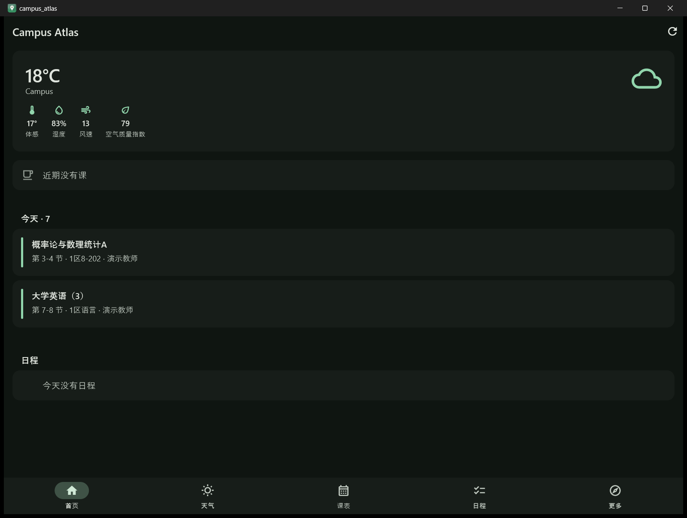
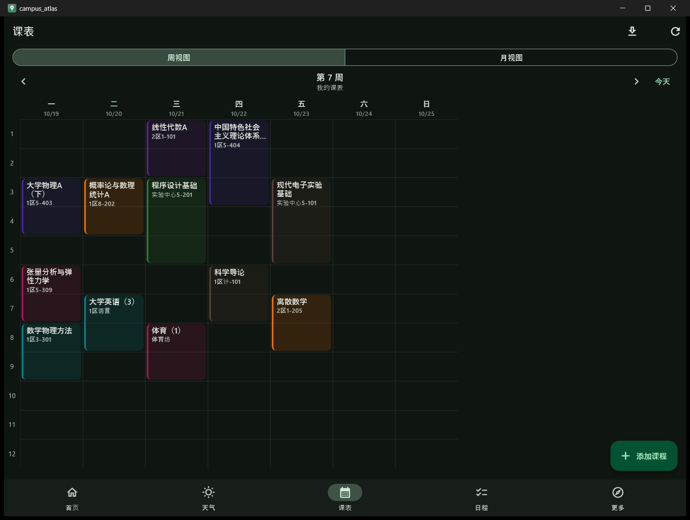
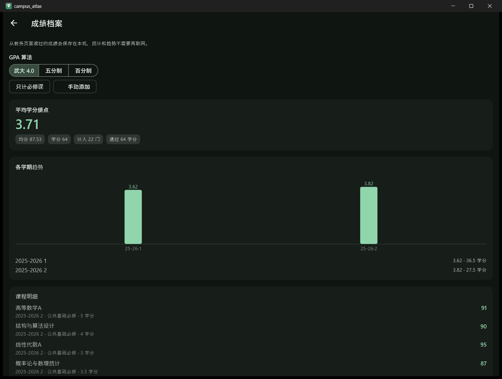
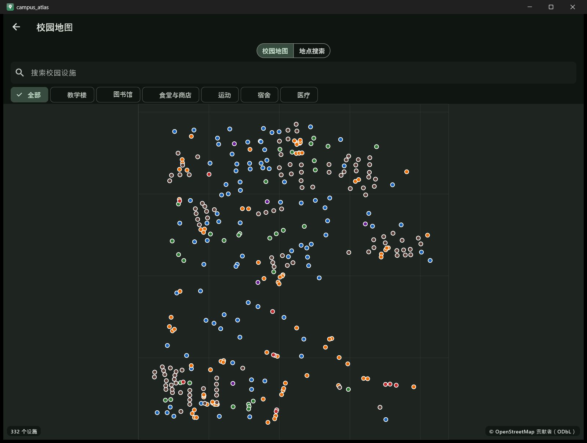
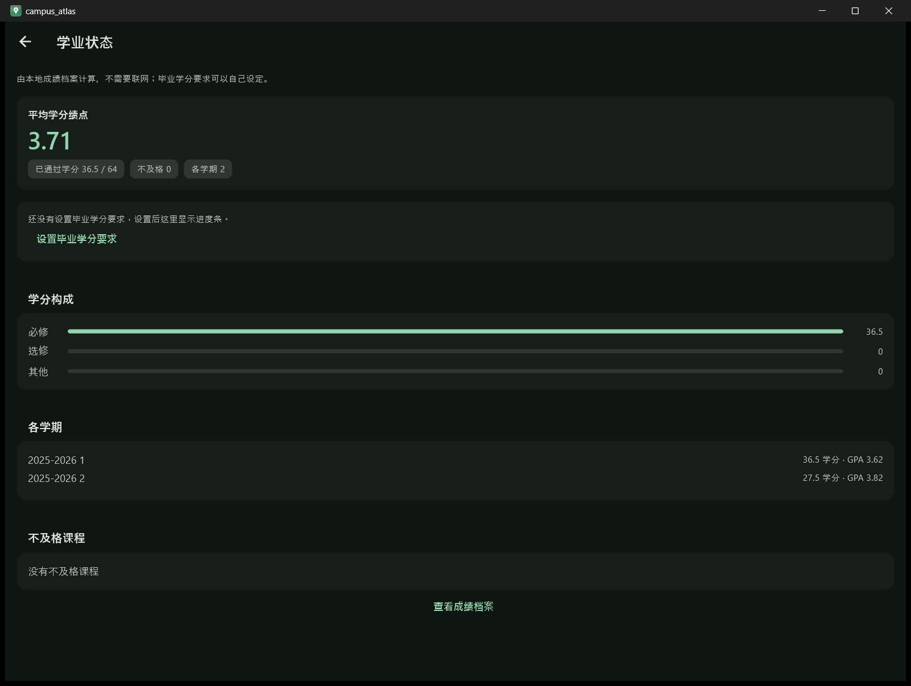
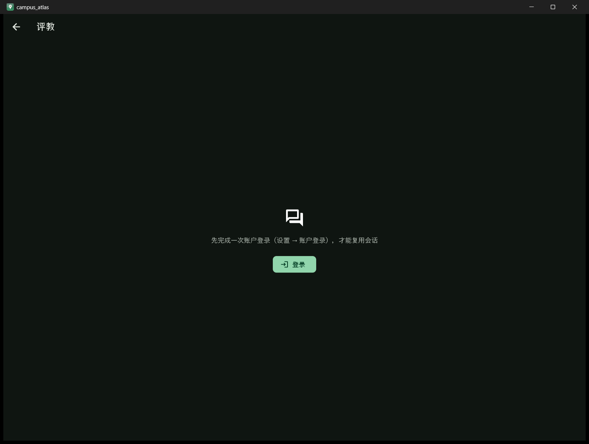
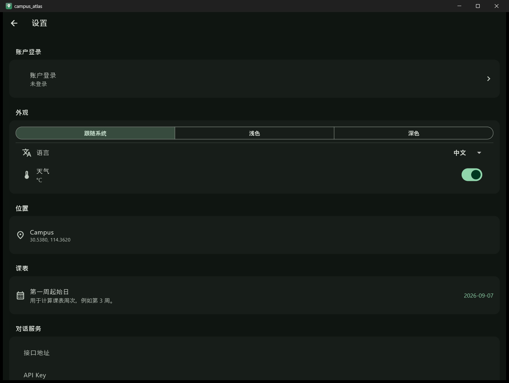

# Campus Atlas

**独立的跨平台校园助手** —— 一次登录，把课表、成绩、评教入口、校园地图和日程放在同一个窗口里。

An independent, cross-platform campus companion: one sign-in, and the
timetable, the grade archive, the evaluation entry, the campus map and the
agenda all live in the same window.

[](https://github.com/yasunosubaru/campus-atlas/actions/workflows/ci.yml) [](https://docs.flutter.dev) [](https://dart.dev) [](LICENSE)  

[下载 Release](https://github.com/yasunosubaru/campus-atlas/releases) ·
[报告缺陷](https://github.com/yasunosubaru/campus-atlas/issues) ·
[参与贡献](CONTRIBUTING.md) ·
[安全策略](SECURITY.md)

---

## 目录

- [项目概况](#项目概况)
- [独立性声明](#独立性声明)
- [功能矩阵](#功能矩阵)
- [界面](#界面)
- [一次登录解锁全部](#一次登录解锁全部)
- [技术构成](#技术构成)
- [开始使用](#开始使用)
- [架构](#架构)
- [数据来源与许可](#数据来源与许可)
- [隐私与脱敏](#隐私与脱敏)
- [路线图](#路线图)
- [参与贡献](#参与贡献)
- [代码量](#代码量机维护请勿手改)
- [许可证](#许可证)
- [Notices（开源许可登记）](#notices开源许可登记)
- [致谢](#致谢)

---

## 项目概况

校园里要查的东西散在好几个系统里：课表在教务，成绩在教务另一个页面，评教在另一个域名，
地图谁都不给，气象预报还得自己找。这个应用把它们收进一个窗口，并且**只让用户登录一次**。

这不是"再写一个教务客户端"。它的取舍是：

- **只读优先**。应用读你的课表、成绩、给分分布，然后把统计留在本机；它不代填任何表单，
  不代过任何验证，不替你提交任何评价。
- **把验证留给本人**。教务的课表与成绩查询挂着一个滑块挑战，CAS 还会对"不被信任的浏览器"
  追加短信 / 动态码 / 扫码。应用把这些页面**原样开在应用内浏览器里**，你做完它再读结果——
  它不替你拖滑块。
- **不猜没有的契约**。没有拿到的接口（研究生课表、Ham 写入、评教表单）就明确标为不可用，
  而不是编一个看起来能用的界面。
- **本机留档**。成绩读一次就存在本机，之后 GPA、趋势、学分构成全部离线可算。

<div align="center">

| 首页 | 课表 | 成绩档案 | 校园地图 |
|---|---|---|---|
|  |  |  |  |

| 学业状态 | 评教入口 | 设置 | |
|---|---|---|---|
|  |  |  | |

</div>

> 截图里的课表与成绩是**合成演示数据**（课程名、教师、教室均为示例），
> 仓库里不含任何真实学号、姓名或分数。

---

## 独立性声明 / Independence statement

本项目与 **Luotopia（珞家）**、ClosedWHU、武汉大学及其任何官方应用**没有关联**，
**未获其背书**，也**不复制其任何素材**。

This project is **not affiliated with, endorsed by, or derived from** Luotopia
(珞家), the ClosedWHU organisation, Wuhan University, or any official campus
application. It copies **none** of their assets.

具体而言 / Specifically, this project:

- ✅ 自行编写全部代码，仅实现观察到的**功能**
- ✅ 只使用公开、免密钥的数据源，以及用户自己的凭据
- ❌ 不复制原应用的图标、图片、`assets/data/*.json` 数据文件、语言包
- ❌ 不复制其 UI 观感或品牌名称
- ❌ 不打包任何专有二进制（尤其 **Sangfor / 深信服 VPN 扩展**）
- ✅ 使用完全独立的名称与品牌

Original code implements observed *functionality*; no assets, UI design, i18n
files, data files, branding, or proprietary binaries are copied.

---

## 功能矩阵

| 模块 | 状态 | 数据源 |
|---|---|---|
| 天气实况 + 七日预报 + 空气质量 | ✅ 完整实现 | [Open-Meteo](https://open-meteo.com)（免密钥） |
| 校园地图（原生、离线设施图层） | ✅ 完整实现，332 个设施点 | OpenStreetMap 数据快照（ODbL，见下） |
| 地点搜索 | ✅ 完整实现 | [OpenStreetMap Nominatim](https://nominatim.org)（免密钥，限速 1 req/s） |
| 课表：多课表 / 周月视图 / 周次解析 | ✅ 完整实现 | 本地存储 |
| 课表：教务导入（N2151） | ✅ 完整实现（页面级滑块由本人完成） | 正方教务 N2151 |
| 上课提醒 | ✅ 完整实现（应用内，前台） | 本地课表 |
| 日程：截止日 / 重复规则 | ✅ 完整实现 | 本地存储 |
| 成绩档案 / 学业状态 | ✅ 完整实现（GPA 三种算法、学期趋势、学分构成） | 本地存储（成绩从教务读一次） |
| 评教入口（`POST /loginSSO`） | ✅ 入口解析（表单不代填） | 评教系统 / 本地草稿 |
| 账户登录（一次登录解锁全部） | ✅ 完整实现（应用内浏览器 + 设为应用会话） | 学校 CAS |
| 给分分布 / 我的 Ham | ✅ 只读实现（提交与写评价未开放） | Ham MCP |
| AI 对话（流式、可配置端点） | ✅ 完整实现 | 任意 OpenAI 兼容端点 |
| 设置（主题 / 语言 / 位置 / 端点） | ✅ 完整实现 | 本地存储 |
| 全校总课表 + 蹭课匹配 | ✅ 完整实现 | OpenStreetMap + 本地课程库 |
| 研究生系统课表 | ⛔ 接口未取得 | — |
| 评教表单提交 / 提交成绩 | ⛔ 写入接口未取得 | — |

每个 ⛔ 都写明了**为什么**不是代码问题：没有契约就不做猜测实现。

---

## 一次登录解锁全部

这是整个应用里最需要解释的一段。

教务的课表与成绩查询挂着一个**滑块挑战**，CAS 又会因为"浏览器不可信"要求**二次认证**。
纯 HTTP 客户端过不去；所以应用把页面**原样开在应用内浏览器**（Windows 上是 runner 自己创建的
WebView2 窗口，不是 Flutter 平台视图——release 构建里平台视图整窗发黑，见
`lib/features/grades_query/jwgl/native_webview.dart`），由**本人**完成页面要求的一切，
完成后点右上角钥匙「设为应用会话」，浏览器里的 cookie 就成了应用的会话。

```
        ���户登录（设置 → 账户登录）
                  │
                  ▼
     ┌────────────────────────────┐
     │  应用内浏览器：CAS 登录页   │   ← 本人完成：滑块 / 短信 / 动态码 / 扫码
     └────────────────────────────┘
                  │  点「设为应用会话」
                  ▼
        浏览器 cookie → 应用会话（内存，2 小时）
                  │
     ┌────────────┼────────────┬─────────────┐
     ▼            ▼            ▼             ▼
   课表导入      成绩读取     评教入口      给分分布
   N2151 页面    成绩页表格   /loginSSO     Ham MCP
```

一次登录，四条链共用同一个会话。凭据只在这一次输入，应用不保存密码。

---

## 技术构成

- **Flutter 3.24+ / Dart 3.5+**，Windows / macOS / Linux / Web 一套代码
- **零运行时平台服务依赖**：不用 Firebase、不用任何账号云服务、不内置任何 API Key
- 依赖只有五个：<code>http</code>、<code>shared_preferences</code>、<code>url_launcher</code>、
  <code>intl</code>、<code>crypto</code>（+ <code>pointycastle</code>，仅用于 CAS 表单自己的
  AES-CBC 密码加密）
- 网络出口只有一个：`lib/core/network/api_client.dart`（统一超时、重试、失败分类、认证头）
- 存储是本机 KV（<code>shared_preferences</code>）+ JSON 文档，**没有数据库依赖**

---

## 开始使用

### 前置条件

- Flutter ≥ 3.24（Dart ≥ 3.5）。本仓库在 Flutter 3.47.7 / Dart 3.13.5 上验证
- Windows 10/11 上需要 **WebView2 Runtime**（Win11 自带；Win10 需 Edge WebView2 Runtime）

### 构建与运行

```bash
git clone https://github.com/yasunosubaru/campus-atlas.git
cd campus-atlas

flutter pub get
flutter analyze        # 0 issues
flutter test           # 770 tests
flutter run -d windows # 或 -d macos / -d linux / -d chrome
```

发布构建：

```bash
flutter build windows --release   # build/windows/x64/runner/Release/
```

### 配置 AI 对话（可选）

设置 → 对话服务 → 填入任意兼容 OpenAI 接口的 Base URL（`llama.cpp`、Ollama、vLLM、
LM Studio、OpenAI 等），可选 API Key 与模型名，点「测试连接」验证。
**应用内不内置任何 API Key。**

### 账号登录（可选）

设置 → 账户登录 → 在应用内浏览器完成登录 → 点右上角钥匙「设为应用会话」。
没有账号也能用：天气、地图、日程、课表手动添加、设置都不需要登录。

---

## 架构

Feature-first clean architecture。横切关注点在 `lib/core/`，业务模块在 `lib/features/<name>/`。

```
lib/
├── main.dart                    # 组合根：装配依赖、主题、语言
├── shell.dart                   # 底部导航
├── home_screen.dart             # 仪表盘
├── core/
│   ├── result.dart              # Result<T> / AppFailure：显式失败
│   ├── network/api_client.dart  # 统一超时、重试、失败分类、逐跳重定向
│   ├── storage/settings.dart    # KV 抽象 + 类型化设置
│   ├── i18n/                    # 手写双语表（可测、无 codegen）
│   ├── theme/                   # M3 主题
│   └── widgets/common.dart      # AsyncView / ErrorState / EmptyState
└── features/
    ├── weather/                 # Open-Meteo 实况、预报、空气质量
    ├── campus_map/              # 原生校园地图（OSM 快照）+ Nominatim 搜索
    ├── courses/                 # 全校总课表、蹭课匹配
    ├── timetable/               # 多课表、周/月视图、N2151 导入、上课提醒
    ├── agenda/                  # 待办 + 截止日 + 重复规则
    ├── grades_query/            # 成绩档案、GPA/趋势、学业状态、Ham 给分
    ├── teaching_eval/           # 评教入口（/loginSSO）、评价草稿
    ├── ai_chat/                 # OpenAI 兼容客户端（含 SSE 流式）
    ├── whu_auth/                # CAS 登录、会话接管、Cookie 作用域
    └── settings/                # 设置页、位置选择器
```

### 几个有意的设计决定

**`Result<T>` 而非异常。** 校园后端的失败方式很有意思（CAS 会话过期、门户页
用 HTML 冒充 JSON、维护窗口）。抛异常跨越仓储边界会丢失**失败的种类**，而
UI 正是靠种类来决定是"给个重试"还是"请重新登录"。

**`ApiClient` 是唯一的网络出口。** 截止时间、有界重试、失败分类、认证头注入
收敛到一处，业务仓储无需各自记住这些规则，测试也能直接注入 fake client。

**只重试能被重试修复的错误。** 断网、超时、5xx 会重试；401 和解析失败不会——
服务器已经给出答案，重放不会改变它。

**逐跳计算 cookie。** `package:http` 的自动重定向会把第一跳的 cookie 原样发给所有主机，
而 CAS 票据只在签发它的那个主机上——单点登录正是断在这里。`getFollowing()` 手动逐跳跟随，
每跳按该跳的 URI 重算 cookie 头。

**手写 i18n 而非 `gen_l10n`。** 去掉 codegen 步骤，翻译表就是一份可直接 review
的源文件，且缺失 key 由测试兜底。

**课表用 JSON 存 KV 而非数据库。** 一学期几十行、变更由用户显式触发，
不值得为此引入原生数据库依赖并让 `flutter test` 依赖 platform channel。

**验证交给人。** 应用只读**页面已经画出来**的内容（成绩表格、课表列表），
不重放、不模拟、不代拖滑块。

---

## 数据来源与许可

- **校园地图**的 332 个设施点来自 OpenStreetMap（2026-10-19 的快照，不是实时数据），
  © OpenStreetMap contributors，按 [ODbL](https://opendatacommons.org/licenses/odbl/) 使用；
  应用内地图上常驻署名，点击可打开版权页。
- **地点搜索**走 Nominatim 公共服务，客户端限速 1 req/s。
- **天气与空气质量**走 Open-Meteo，免密钥。
- **不打包**任何第三方的 ZIM、题库或受限数据。

---

## 隐私与脱敏

这个应用会碰到学号、成绩、课表——所以下面几条是硬约束，不是口号：

- **不存密码。** CAS 密码只在应用内浏览器里输入一次，cookie 抓回来后只在内存里活 2 小时。
- **学号只在用的时候在。** 评教入口的学号是一次性的输入框，界面上写着"仅本次使用，不保存"。
- **Ham 令牌不进仓库。** 用户自己的 30 天令牌只存在本机。
- **凭据只走环境变量。** e2e 脚本从 `E2E_STUDENT_ID` / `E2E_PASSWORD` 读，仓库里没有凭据。
- **CI 有一道脱敏守卫。** `tools/check_desensitization.py` 扫入库文本里的
  用户目录路径、手机号、邮箱、13 位学号形状与私钥/token 形状；命中即让 CI 变红。
- **发布截图用合成数据。** 课表与成绩的截图来自演示数据集，不含真实身份与分数。

```bash
python tools/check_desensitization.py     # 本地跑一遍，退出码非 0 即命中
```

个人姓名、学号、电话、邮箱不进这个仓库，它是公开的。

---

## 路线图

- [x] 课表（多课表 / 周月视图 / 教务导入）、日程、天气、地图
- [x] 成绩档案与学业状态（三种 GPA 算法、学期趋势、学分构成）
- [x] 一次登录解锁教务三链（课表 / 成绩 / 评教入口）
- [x] 全校总课表与蹭课匹配
- [x] 评教草稿（本地写、复制、提交时粘贴）
- [x] 给分分布与课程评论（Ham 只读）
- [ ] 研究生系统课表渠道（需要一次研究生账号的会话）
- [ ] 评教表单契约（表单仍需人工填写提交）
- [ ] 系统级上课提醒（当前只做应用内提示）
- [ ] 更多平台发布（Microsoft Store 等）

[开放议题](https://github.com/yasunosubaru/campus-atlas/issues) 里能看到全部提案与已知问题。

---

## 参与贡献

有想法就提 [issue](https://github.com/yasunosubaru/campus-atlas/issues/new)，
也可以 fork 后直接发 PR。贡献流程与提交自检见
[CONTRIBUTING.md](CONTRIBUTING.md)。

### 提交时的自检

```bash
flutter analyze                 # 必须 0 issues
flutter test                    # 必须全绿
python tools/check_desensitization.py
```

---

## 代码量（机维护，请勿手改）

- 入库 Dart 源文件：**87** 个
- 入库 Dart 源码行数：**26,073** 行
- 入库测试文件：**46** 个
- 入库测试行数：**9,819** 行
- 功能模块数：**11** 个

> 口径：`lib/` 与 `test/` 下的 `.dart` 文件，未入库文件不计。

---

## 许可证

本仓库采用 [MIT](LICENSE)。

一句话版本：宽松、无附加义务、不限制后续把同一套代码用于论文、专利或软著。

本 MIT 只覆盖**本仓库自有的原创代码**，不能也不授予任何第三方应用、素材或商标的权利。

---

## Notices（开源许可登记）

| 项目 | 用在本仓库的哪里 | 许可 |
|---|---|---|
| Flutter / Dart | 全部应用代码 | BSD-3-Clause |
| [http](https://pub.dev/packages/http) | HTTP 客户端 | BSD-3-Clause |
| [shared_preferences](https://pub.dev/packages/shared_preferences) | 本机 KV 存储 | BSD-3-Clause |
| [url_launcher](https://pub.dev/packages/url_launcher) | 在系统浏览器里打开解析出的入口 | BSD-3-Clause |
| [intl](https://pub.dev/packages/intl) | 日期与数字格式化 | BSD-3-Clause |
| [crypto](https://pub.dev/packages/crypto) | Altcha 工作量证明校验 | BSD-3-Clause |
| [pointycastle](https://pub.dev/packages/pointycastle) | CAS 表单自己的 AES-CBC 加密 | MIT |
| [OpenStreetMap](https://www.openstreetmap.org/copyright) | 校园地图的 332 个设施点 | ODbL |
| [Open-Meteo](https://open-meteo.com/) | 天气与空气质量 | CC-BY 4.0（数据）/ AGPL（服务） |
| [Nominatim](https://nominatim.org/) | 地点搜索 | ODbL（数据）/ GPLv2（服务） |
| [uiautomation](https://github.com/yinkaisheng/Python-UIAutomation-for-Windows) | e2e 驱动脚本（仅开发用） | MIT |

徽章与许可标志只是速记，以本表为准。

---

## 致谢

- [OpenStreetMap](https://www.openstreetmap.org/) 贡献者：校园地图的每一个设施点
- [Open-Meteo](https://open-meteo.com/)：天气与空气质量，免密钥
- [Flutter](https://flutter.dev/)：一套代码，四个平台

---

## 联系方式

个人姓名、学号、电话、邮箱不进这个仓库，它是公开的。协作走这里：

- 缺陷与需求：[开放议题](https://github.com/yasunosubaru/campus-atlas/issues)
- 安全问题：见 [SECURITY.md](SECURITY.md)（不要开公开 issue）
